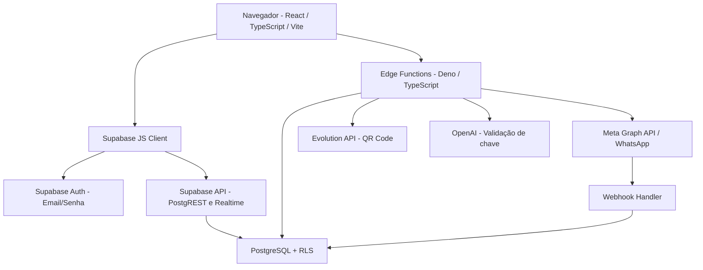

<div align="center">
  
  <h1>💬 Converso — CRM Multicanal</h1>
  <p>Plataforma web de atendimento, caixa de entrada, contatos, CRM, chatbots, campanhas e automações.</p>
  <p>
    
    
    
  </p>
</div>

---

## 📖 Visão Geral

O **Converso** é um projeto de plataforma web responsiva, criado no **Bolt.new** como uma aplicação de atendimento multicanal e CRM inspirada em soluções como o ChatGuru. O nome **Converso** aparece na tela de login, menu e migrações; o `package.json` ainda utiliza o nome técnico original `vite-react-typescript-starter`.

O sistema reúne **dashboard, caixa de entrada, contatos, funil CRM (Kanban), construção visual de chatbots, automações, campanhas, agendamentos, relatórios, equipes e configurações de integrações**.

A interface está implementada em **React + TypeScript + Vite**, com **Tailwind CSS** e ícones **Lucide React**. Os dados são acessados pelo cliente `@supabase/supabase-js`, com **PostgreSQL e autenticação do Supabase**. Três funções de backend usam **Deno/TypeScript no Supabase Edge Functions**. Não existem Next.js, Express, Prisma, MySQL ou API Node própria neste ZIP.

A identidade visual atual usa **azul, branco, cinza e tons escuros**. O projeto inclui um `dist/` de build já gerado; a referência para alterações é sempre `src/`.

> **Estado do projeto:** diversas telas e operações de banco estão implementadas, mas partes essenciais de envio de WhatsApp, execução de chatbots/automações, campanhas e agendamentos **não foram implementadas de ponta a ponta**. A existência de código de conexão não comprova que o serviço remoto esteja ativo.

---

## 🎯 Objetivos

- Centralizar atendimentos em uma caixa de entrada associada a contatos.
- Organizar contatos, etiquetas e etapas de negociação em um CRM Kanban.
- Registrar e consultar mensagens, anotações internas e respostas rápidas.
- Administrar atendentes, equipes, papéis e organizações.
- Projetar fluxos de chatbot e regras de automação.
- Criar campanhas segmentadas e agendar ações.
- Apresentar indicadores de atendimento, mensagens e oportunidades.
- Integrar o sistema ao WhatsApp Business Platform, a um provedor do tipo Evolution API e à OpenAI.
- Receber e registrar webhooks de mensagens de entrada do WhatsApp oficial.
- Proteger dados por autenticação, papéis e políticas de acesso (RLS).
- Oferecer uma interface adaptável a computadores e celulares.
- **Próxima etapa:** concluir as rotinas operacionais e corrigir as pendências de segurança e banco antes da produção.

---

## 🚀 Tecnologias Utilizadas

<div align="left">
  
  
  
  
  
  
  
  
</div>

| Camada | Tecnologia identificada | Origem |
|---|---|---|
| Frontend | React `^18.3.1`, React DOM | `package.json`, `src/` |
| Linguagem | TypeScript `^5.5.3` / TSX | `package.json`, `src/**/*.tsx` |
| Build e desenvolvimento | Vite `^5.4.2` | `vite.config.ts`, `package.json` |
| Estilo | Tailwind CSS `^3.4.1`, PostCSS, Autoprefixer | `src/index.css`, configurações |
| Ícones | Lucide React `^0.446.0` | `package.json` |
| Autenticação e dados | Supabase JS `^2.57.4` | `src/lib/supabase.ts` |
| Banco remoto | PostgreSQL (serviço Supabase) | `supabase/migrations/*.sql` |
| Backend de integração | Supabase Edge Functions — Deno/TypeScript | `supabase/functions/` |
| Ambiente de desenvolvimento | Node.js + npm | scripts Vite no `package.json` |
| SQL | PostgreSQL / PL/pgSQL, com Row Level Security (RLS) | migrações |

**Não utilizados neste projeto:** Next.js, Express, Prisma e MySQL. **Node.js é utilizado para desenvolver e compilar o frontend**, não como um servidor REST Express próprio.

---

## 🚀 Funcionalidades

As marcações `[x]` significam **implementação localizada no código** (sem comprovação de funcionamento contra o serviço remoto); `[ ]` indica operação inexistente, incompleta ou que requer correção.

- [x] Cadastro, login e logout com e-mail/senha via Supabase Auth.
- [x] Sessão persistente e renovação automática de token.
- [x] Perfis de organização `owner`, `admin` e `agent`.
- [x] Estrutura de perfil no banco: nome, avatar e telefone; a interface própria de edição de perfil não está presente.
- [x] Dashboard com indicadores consultados nas tabelas do Supabase.
- [x] Caixa de entrada com conversas, histórico, pesquisa e filtros.
- [x] Registro de mensagens de atendente no banco e assinatura Realtime da caixa de entrada.
- [x] Alteração de status de conversas, atribuição, notas e etiquetas.
- [x] Cadastro, edição e exclusão de contatos.
- [x] CRM Kanban com mudança de etapa e valor de oportunidade.
- [x] Editor de fluxos de chatbot, com gravação, edição e ativação visual.
- [x] Cadastro de gatilhos e ações de automações.
- [x] Cadastro de campanhas e criação de registros de destinatários.
- [x] Cadastro e cancelamento de agendamentos.
- [x] Relatórios básicos calculados a partir dos dados cadastrados.
- [x] Gerenciamento parcial de equipes, permissões e usuários já associados.
- [x] Configuração de integração WhatsApp oficial, Evolution API, OpenAI e URL de webhook.
- [x] Função de recebimento de mensagens **do WhatsApp oficial** via webhook (depende de deploy e credenciais).
- [x] Estrutura de 23 tabelas, políticas RLS e 10 arquivos de migração SQL.
- [ ] Envio de mensagens **para o WhatsApp** quando o atendente clica em enviar (hoje o frontend grava no banco).
- [ ] Execução automática dos fluxos de chatbot salvos.
- [ ] Motor para executar os gatilhos/ações das automações.
- [ ] Disparo real de campanhas e atualização confiável de entrega/leitura (o clique atual cria destinatários e muda contadores).
- [ ] Execução efetiva dos envios em horários agendados (não há worker/cron de disparo).
- [ ] Convite real por e-mail para novos atendentes (a tela exibe mensagem informativa).
- [ ] Tela própria de edição de perfil e fluxo de recuperação de senha no frontend.
- [ ] Sincronização completa de status de mensagens do WhatsApp e cobertura de eventos webhook.
- [ ] Tratamento completo do QR Code da integração não oficial (a função inicia conexão, mas não confirma pareamento).
- [ ] Resolver a divergência entre criação de organização compartilhada e individual nas migrações.
- [ ] Corrigir e testar a função `seed_demo_data`, cujo SQL tem comandos `RETURNING` inconsistentes com múltiplas linhas.
- [ ] Testes automatizados, validação operacional do banco remoto e revisão de segurança para produção.

**Atenção:** a função `seed_demo_data(uuid)` está definida no SQL, mas não há chamada a ela em `src/`. O projeto **não cria automaticamente uma conta de administrador com senha fixa**.

---

## 🏗 Arquitetura do Sistema



**Estrutura real do ZIP (pasta `project/`):**

```text
project/
├── .bolt/                  # Template e prompt usados pelo Bolt
├── .env                    # URL e chave pública do Supabase (não publicar)
├── .gitignore              # Exclui .env, node_modules e dist do Git
├── dist/                   # Build estático já gerado; não é o código-fonte
├── index.html              # Página HTML de entrada
├── package.json            # Dependências e comandos npm
├── package-lock.json       # Dependências travadas
├── vite.config.ts          # Vite e alias @ -> src/
├── tailwind.config.js      # Configuração do Tailwind
├── postcss.config.js       # Configuração do PostCSS
├── eslint.config.js        # Verificação estática
├── tsconfig*.json          # Configurações TypeScript
├── src/
│   ├── App.tsx             # Orquestra autenticação e páginas
│   ├── main.tsx            # Ponto de entrada React
│   ├── index.css           # Tema visual e estilos
│   ├── components/         # Menu, shell, modal, alertas e componentes UI
│   ├── contexts/           # AuthContext e OrgContext
│   ├── lib/supabase.ts     # Criação do cliente Supabase
│   ├── pages/              # 12 páginas TSX: login + 11 módulos internos
│   ├── types/index.ts      # Tipos das entidades
│   └── vite-env.d.ts       # Tipagem do Vite
└── supabase/
    ├── config.toml         # Configuração de autenticação das Edge Functions
    ├── functions/
    │   ├── whatsapp-api/   # Conectar/desconectar integrações WhatsApp
    │   ├── webhook-handler/# Receber webhooks oficiais da Meta
    │   └── integration-api/# Configuração de OpenAI e webhooks
    └── migrations/         # 10 migrações SQL do banco
```

**Banco de dados:** 23 tabelas definidas nos arquivos SQL:

`organizations`, `org_members`, `teams`, `team_members`, `contacts`, `tags`, `contact_tags`, `conversations`, `conversation_tags`, `messages`, `internal_notes`, `quick_replies`, `attachments`, `chatbots`, `automations`, `campaigns`, `campaign_recipients`, `schedules`, `audit_logs`, `integrations`, `webhook_events`, `user_profiles` e `integration_credentials`.

**Projeto Supabase configurado no ZIP:** `jnlnbotqjjugtppggorb`, endpoint `https://jnlnbotqjjugtppggorb.supabase.co`. A URL identifica o projeto remoto **configurado**, não confirma banco operacional ou autorização de acesso. A senha PostgreSQL, chave `service_role` e contas existentes **não aparecem no ZIP**.

> **Segurança:** `integration_credentials` restringe acesso do navegador por RLS e permissões. Os tokens estão armazenados em colunas `text`; não há criptografia adicional de segredo implementada no código analisado. A validação de assinatura do webhook oficial só é exigida se `app_secret` tiver sido configurado. As três Edge Functions usam `verify_jwt = false` e, quando necessário, validam o usuário dentro do código.

---

## 📦 Instalação

### 1. Pré-requisitos

Instale:

- [Node.js](https://nodejs.org/) — recomendado Node.js 20 ou 22, com npm.
- [Git](https://git-scm.com/downloads) — útil **caso** o projeto seja colocado em repositório Git.
- [VS Code](https://code.visualstudio.com/) — recomendado para editar o código.
- [Conta Supabase](https://supabase.com/dashboard) com permissão sobre o projeto remoto, se for configurar banco/funções.
- [Supabase CLI](https://supabase.com/docs/guides/local-development/cli/getting-started) — **somente** para gerenciar migrações, projeto remoto e deploy de funções.

**Não é necessário instalar MySQL, PostgreSQL local, Prisma nem Express para executar o frontend apontando para o Supabase remoto.** Para um ambiente Supabase totalmente local, são necessários outros procedimentos (incluindo Docker), não configurados neste ZIP.

### 2. Baixar o projeto

O arquivo fornecido já contém o código-fonte. **Extraia o ZIP** e abra o terminal dentro da pasta `project` (onde está o `package.json`):

```bash
cd project
```

Se futuramente houver um repositório Git, poderá ser usado `git clone <URL_DO_REPOSITORIO>`. **Nenhum endereço de repositório foi informado ou encontrado** neste projeto.

### 3. Instalar as dependências

```bash
npm ci
```

`npm ci` utiliza as versões resolvidas no `package-lock.json`. Alternativamente:

```bash
npm install
```

Comandos existentes no `package.json`:

```bash
npm run dev       # Inicia servidor Vite
npm run build     # Gera o site para produção em dist/
npm run preview   # Pré-visualiza dist/
npm run typecheck # Verifica tipos TypeScript
npm run lint      # Executa ESLint
```

### 4. Configurar as variáveis de ambiente

O projeto já tem um arquivo **`project/.env`**, com duas variáveis:

```env
VITE_SUPABASE_URL=https://jnlnbotqjjugtppggorb.supabase.co
VITE_SUPABASE_ANON_KEY=<COPIAR_O_VALOR_DO_ARQUIVO_.env_ORIGINAL_OU_DO_DASHBOARD>
```

A `VITE_SUPABASE_ANON_KEY` **está presente no ZIP**, mas foi omitida deste README, que pode ser publicado. Ela é uma **chave pública de acesso da aplicação** (papel `anon`), e **não** uma senha administrativa do PostgreSQL, token de serviço nem login de usuário.

Para consultar/gerenciar o projeto, acesse o [Dashboard do Supabase](https://supabase.com/dashboard/project/jnlnbotqjjugtppggorb) com uma conta que já tenha permissão. A URL de banco e a chave pública também podem ser encontradas nas configurações do projeto no dashboard.

O código `src/lib/supabase.ts` usa essas variáveis para criar o cliente, persistir a sessão e renovar tokens.

**Nunca coloque `SUPABASE_SERVICE_ROLE_KEY`, senha do PostgreSQL, tokens da Meta, chave OpenAI ou outros segredos em variáveis `VITE_*`.** Variáveis `VITE_*` ficam expostas ao navegador na compilação.

Para integrações:

- **WhatsApp oficial:** informe `phone_number_id`, `business_account_id`, `access_token` e, para validar webhooks com segurança, `app_secret` na interface de Configurações.
- **Evolution API:** informe URL HTTPS do provedor, nome da instância e `api_key` na interface.
- **OpenAI:** informe sua chave API na interface de Configurações; a função a verifica usando a API de modelos.
- **Webhook externo:** informe a URL HTTPS pela interface.
- **Edge Functions:** usam as variáveis de ambiente do Supabase `SUPABASE_URL`, `SUPABASE_ANON_KEY` e `SUPABASE_SERVICE_ROLE_KEY` **no ambiente de servidor**. Seus valores de servidor não estão no ZIP.

### 5. Preparar o banco de dados

O sistema usa **PostgreSQL hospedado no Supabase**. Não há comandos `npm run db:generate`, `db:push` ou `db:seed` no `package.json`, e **não existe Prisma**.

O ZIP contém **10 migrações SQL**, em `supabase/migrations`, para criar as tabelas e as funções `create_organization`, `seed_demo_data` e `handle_new_user_auto_provision`.

Se você **já utiliza** o projeto remoto `jnlnbotqjjugtppggorb`, **não reaplique automaticamente as migrações** sem verificar histórico, permissões e backup. Para inspecionar com a Supabase CLI:

```bash
npx supabase login
npx supabase link --project-ref jnlnbotqjjugtppggorb
npx supabase migration list
```

Depois de **revisar e corrigir as migrações** e preferencialmente validar em ambiente de testes, a aplicação delas pode ser feita com:

```bash
npx supabase db push
```

**Pendências detectadas antes de qualquer `db push`:** a migração `007` implementa organização compartilhada, enquanto a última migração implementa organização por novo usuário; `006` utiliza `unaccent` sem instalação explícita da extensão no ZIP; `005` usa `RETURNING id INTO` incorretamente em inserções com múltiplos registros. Inspecione também políticas RLS e permissões antes da produção.

Para publicar as três funções, com um projeto corretamente vinculado e permissões de deploy:

```bash
npx supabase functions deploy whatsapp-api
npx supabase functions deploy webhook-handler
npx supabase functions deploy integration-api
```

O arquivo `supabase/config.toml` declara `verify_jwt = false` para as três funções. Elas precisam de suas próprias verificações de autorização e, para o webhook público, validação de assinatura. **Deploy não configura automaticamente os serviços Meta/OpenAI nem habilita envios de WhatsApp.**

A função de dados demonstrativos pode ser chamada manualmente após correção, mas **não é executada pelo frontend** e **não cria usuário administrador**.

### 6. Iniciar o projeto

Na pasta `project/`, execute:

```bash
npm run dev
```

O Vite, sem alteração de configuração, inicia normalmente em:

**http://localhost:5173**

Em outro terminal, para uma verificação estática e build:

```bash
npm run typecheck
npm run lint
npm run build
```

Para pré-visualizar o build já gerado:

```bash
npm run preview
```

**Não é necessário iniciar dois terminais de frontend/backend como num sistema Express**, porque o backend deste projeto reside nos serviços externos do Supabase.

### 7. Acesso inicial

O frontend oferece as opções **Entrar** e **Criar conta gratuita**. Cadastro é feito por `supabase.auth.signUp`; login por `supabase.auth.signInWithPassword`.

- **E-mail de administrador padrão:** não encontrado no ZIP.
- **Senha padrão:** não encontrada no ZIP.
- **Usuários já cadastrados:** não podem ser determinados apenas pelo código exportado.
- **Senha do banco PostgreSQL:** não consta do ZIP.
- **Chave pública Supabase (`anon`) e endpoint:** presentes em `project/.env`.
- **Chave administrativa `service_role`:** apenas referenciada pelas Edge Functions; seu valor não está incluído.

Para criar um usuário de teste, use a opção **Criar conta gratuita**, caso o Supabase remoto permita novos cadastros. A confirmação de e-mail, se exigida, depende das configurações do Supabase Auth. Outra possibilidade, com acesso autorizado ao Supabase, é administrar usuários na seção **Authentication** do dashboard.

**Atenção ao papel de acesso:** a migração final tenta criar uma empresa para cada novo usuário com papel `owner`, enquanto outra migração prevê todos em uma mesma empresa. Corrija essa regra de negócio antes de cadastrar usuários reais. Não use a senha ou o usuário `admin@bmclub.com.br` do README de exemplo: **essas credenciais pertencem ao exemplo e não aparecem neste projeto**.

---

# Usuário padrão para login

- **E-mail:** não definido no código.
- **Senha:** não definida no código.
- **Cadastro:** pela tela **Criar conta gratuita**, condicionado à configuração do Supabase Auth.
- **Banco conectado:** Supabase/PostgreSQL do projeto `jnlnbotqjjugtppggorb` (configurado, não verificado online).
- **Consulta completa de pendências e arquivos:** veja `AUDITORIA_TECNICA.md`.

<div align="center">
  <strong>Converso — CRM Multicanal</strong>
  <p>Atendimentos, contatos e automações em uma plataforma única.</p>
  <sub>Documentação produzida a partir da análise estática do ZIP fornecido. Não foram acessados banco remoto, contas nem serviços externos.</sub>
</div>
